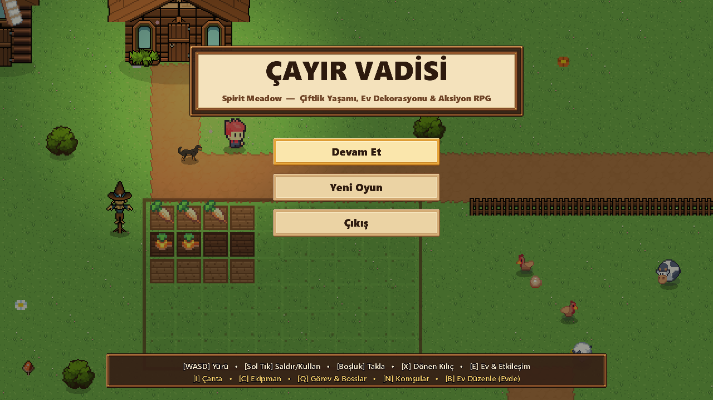
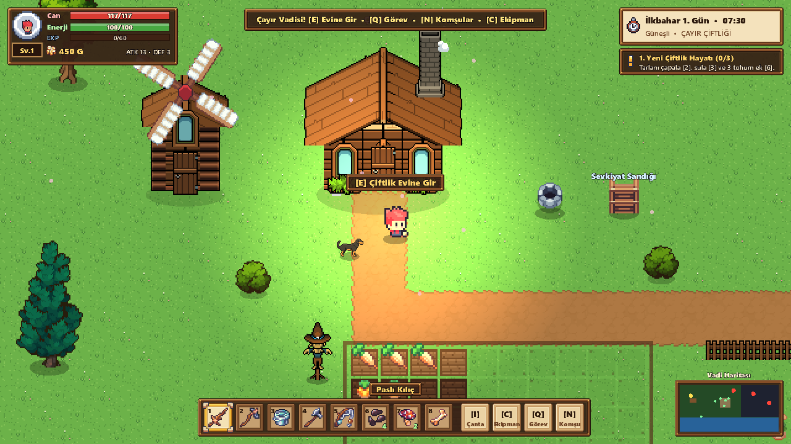
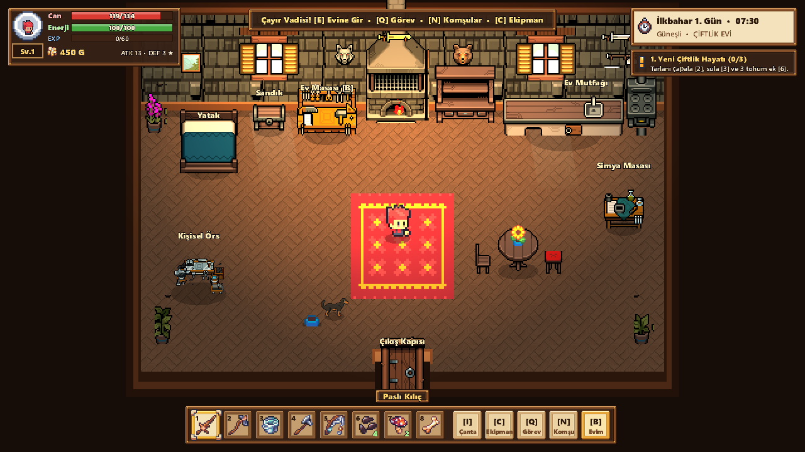
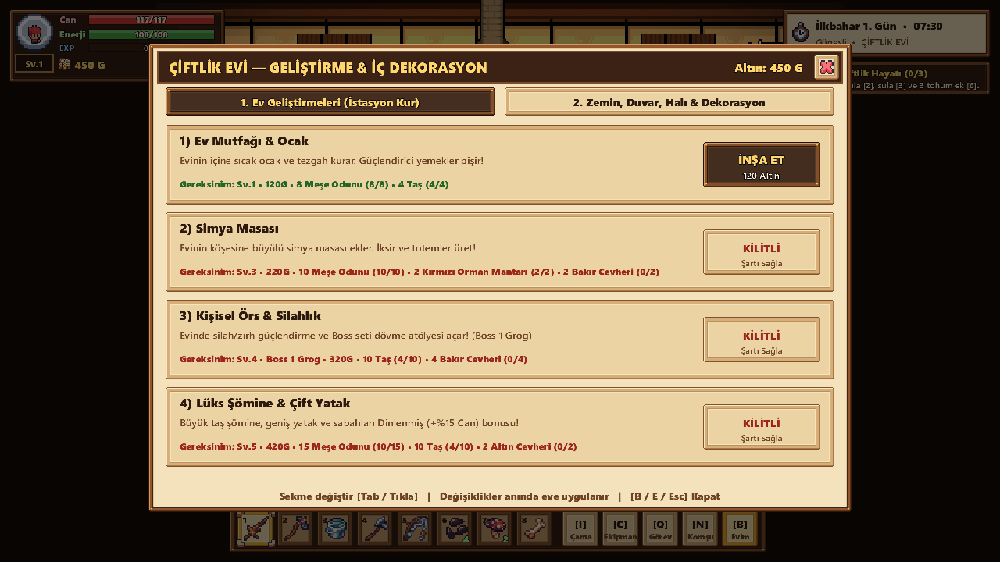
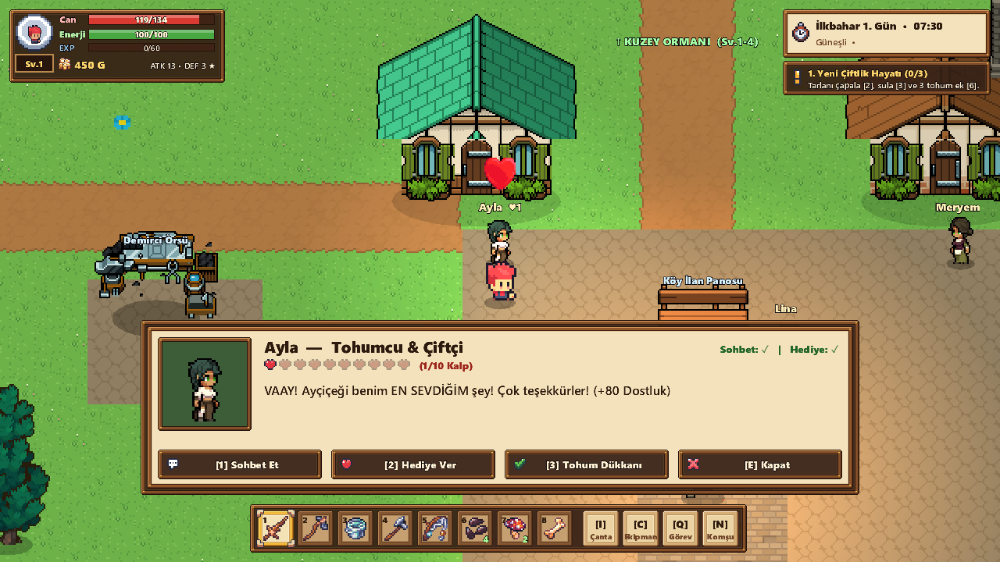
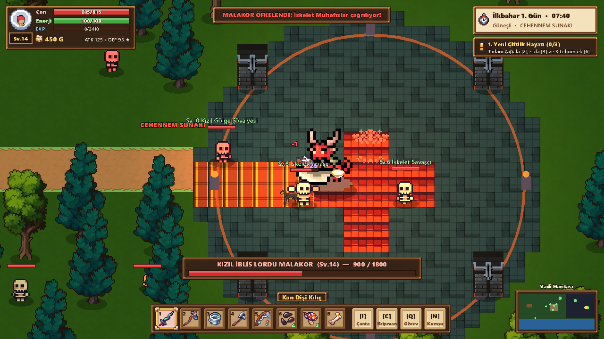

# Çayır Vadisi (Spirit Meadow)

Godot 4.7 ile geliştirilmiş; **çiftlik yaşamı**, **girilebilir ve özelleştirilebilir ev**, **Stardew Valley tarzı komşuluk sistemi** ve **boss avlı aksiyon RPG** mekaniklerini bir araya getiren 2D piksel-art macera oyunu.

## Özellikler

- **Sıcak Ahşap & Parşömen Arayüz**: Oyma ceviz çerçeveler, parşömen paneller, kompakt HUD, alt ahşap hotbar ve canlı vadi haritası.
- **Girilebilir & Özelleştirilebilir Çiftlik Evi**:
  - Kapıdan `[E]` ile evin içine gir, yatakta uyu, ev sandığında eşya depola, Karabaş'ı mama köşesinde sev.
  - **Ev Düzenleme Masası (`[B]` / `[E]`)**: İlerledikçe **Ev Mutfağı**, **Simya Masası**, **Kişisel Örs** ve **Lüks Şömine & Çift Yatak** (+%15 Dinlenmiş Can bonusu) kur.
  - 4 zemin döşemesi, 4 halı modeli, 3 duvar kaplaması ve açılıp kapanabilir dekorasyonlar; yenilen bossların kupaları duvarında otomatik sergilenir.
- **Çiftlik & Yaşam**: Mevsim döngüsü, yağmur/güneş hava durumu, çapalama, sulama, 6 farklı ekin, tavuk/inek/koyun üretimi, sevkiyat sandığı ve Güney Gölü'nde balık avı mini oyunu.
- **Aksiyon RPG & Boss Avı**:
  - 5 zırh kademesine göre görünümü değişen kahraman, takla kaçışı (`[Boşluk]`), Dönen Kılıç yeteneği (`[X]`) ve savaşçı dostun Karabaş (`[R]` kemik atışı).
  - Kuzey Harabesi (**Grog**), Kanlı Mahzen (**Korgath**) ve Cehennem Sunağı (**Malakor**) boss savaşları; demirci örsünde `+1..+5` geliştirme ve efsanevi boss ekipmanı dövme.
- **Köy Komşuları**: Ayla, Demir, Meryem, Bilge Ozan, Kaptan Bram ve Lina ile günlük sohbet, hediye keşfi ve 3♥ / 6♥ kalıcı avantajlar.

## Ekran Görüntüleri

| Ana Menü | Çiftlik & Doğa |
| :---: | :---: |
|  |  |

| Geliştirilmiş Ev İçi | Ev Düzenleme Menüsü |
| :---: | :---: |
|  |  |

| Köy Komşuları & Diyalog | Karakter & Boss Savaşı |
| :---: | :---: |
|  |  |

## Kontroller

| Tuş | İşlev |
| --- | --- |
| `W A S D` / Yön Tuşları | Yürü (`Shift` ile koş) |
| `Sol Tık` / `J` | Seçili aleti kullan / Saldır |
| `Boşluk` | Kaçınma taklası (dışarıda) |
| `X` | Dönen Kılıç alan yeteneği |
| `E` / `Sağ Tık` | Konuş, hasat et, kapı/istasyon etkileşimi |
| `B` | Ev Düzenleme & Dekorasyon menüsü (evdeyken) |
| `1 - 8` | Hotbar yuvası seç (`6`/`7` tekrar basınca tohum/iksir değiştir) |
| `H` / `F` / `R` | Hızlı şifa / Karabaş'ı sev / Kemik at |
| `I` / `C` / `Q` / `N` | Çanta / Ekipman & Zırh / Görevler / Komşular |
| `F5` / `Esc` | Hızlı kaydet / Duraklat |

## Çalıştırma & Doğrulama

- **Gereksinim**: Godot Engine 4.7+ (GL Compatibility)
- Oyunu açmak için `project.godot` dosyasını Godot 4.7 ile çalıştırabilir veya `Oyna_Spirit_Meadow.bat` dosyasını kullanabilirsiniz.
- Otomatik doğrulama ve ekran görüntüsü testi:
  ```powershell
  $env:SPIRIT_TEST="1"
  godot --path .
  ```
